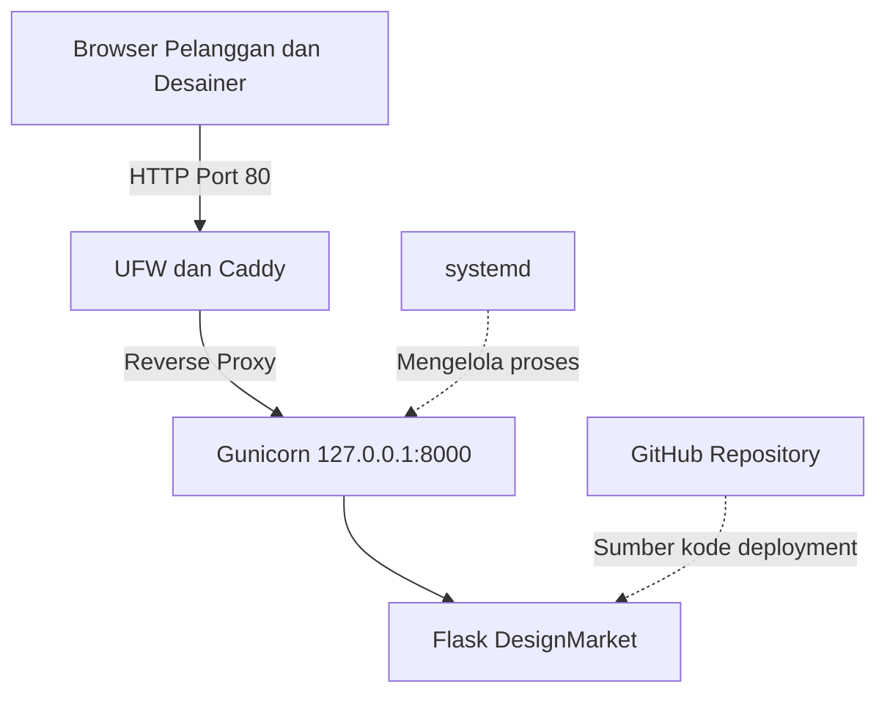

# Architecture v0.1 — DesignMarket

## 1. Gambaran Umum
DesignMarket adalah proyek marketplace jasa desain berbasis web yang direncanakan untuk menghubungkan pelanggan dengan desainer independen. Pada M03, aplikasi dibangun sebagai fondasi awal menggunakan Flask dan dijalankan pada VPS Ubuntu Server 24.04 LTS.

## 2. Tujuan Arsitektur
- Menyediakan halaman utama dan katalog contoh jasa desain.
- Menyediakan endpoint /health dan /api/info.
- Menjalankan aplikasi melalui Gunicorn dan systemd.
- Menggunakan Caddy sebagai reverse proxy.
- Membatasi akses langsung ke backend menggunakan loopback.
- Menyiapkan fondasi pengembangan marketplace pada pertemuan berikutnya.

## 3. Komponen Sistem

| Komponen | Fungsi |
|---|---|
| Browser | Mengakses antarmuka web DesignMarket |
| VPS Ubuntu 24.04 LTS | Menjalankan aplikasi dan layanan server |
| UFW | Mengatur akses jaringan pada VPS |
| Caddy | Menerima HTTP publik dan meneruskan permintaan ke backend |
| Gunicorn | Menjalankan aplikasi Flask sebagai WSGI server |
| Flask | Menangani halaman utama, katalog contoh, dan endpoint aplikasi |
| systemd | Mengelola proses Gunicorn |
| GitHub | Menyimpan kode sumber dan dokumentasi proyek |

## 4. Diagram Arsitektur

## 5. Alur Request
1. Pengguna mengakses alamat IP publik VPS melalui browser.
2. Permintaan HTTP masuk melalui port 80 yang diizinkan UFW.
3. Caddy meneruskan permintaan ke Gunicorn pada 127.0.0.1:8000.
4. Gunicorn menjalankan aplikasi Flask DesignMarket.
5. Flask memberikan respons halaman atau data endpoint kepada pengguna melalui Caddy.

## 6. Keamanan Dasar
- Akses SSH menggunakan kunci publik dan akun non-root.
- Backend Gunicorn hanya mendengarkan pada 127.0.0.1:8000.
- UFW membatasi port yang dapat diakses dari luar.
- Secret dan private key tidak dimasukkan ke repository GitHub.
- Konfigurasi SSH diuji sebelum login root dan password dinonaktifkan.

## 7. Batasan M03
- Katalog jasa desain masih berupa data contoh.
- Belum menggunakan database produksi.
- Belum menyediakan login dan transaksi nyata.
- Belum menerapkan pembayaran otomatis dan komisi marketplace.
- Domain dan HTTPS direncanakan pada tahap berikutnya.

## 8. Rencana Pengembangan
- Menambahkan database untuk data pengguna, desainer, dan layanan.
- Mengembangkan autentikasi pelanggan, desainer, admin, dan owner.
- Mengembangkan pemesanan dan pengelolaan transaksi.
- Menambahkan mekanisme komisi dan laporan pendapatan.
- Mengembangkan deployment dan otomatisasi sesuai tahapan modul berikutnya.
  
